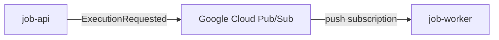

# Job execution request contract 0.1.0 documentation

* Default content type: [application/protobuf](https://www.iana.org/assignments/media-types/application/protobuf)

The asynchronous contract used to request execution of a job.

`job-api` publishes an execution request to Google Cloud Pub/Sub. A push
subscription delivers that request to `job-worker`. Subscription resource
names, push endpoint URLs, IAM, and other deployment configuration are
deliberately outside this contract.




## Table of Contents

* [Servers](#servers)
  * [googleCloudPubSub](#googlecloudpubsub-server)
* [Operations](#operations)
  * [SEND execution-request](#send-execution-request-operation)
  * [RECEIVE execution-request](#receive-execution-request-operation)

## Servers

### `googleCloudPubSub` Server

* URL: `googlepubsub://googleapis.com/`
* Protocol: `googlepubsub`

Logical Google Cloud Pub/Sub broker. Project and resource configuration is environment-specific.


## Operations

### SEND `execution-request` Operation

*Publish an execution request.*

* Operation ID: `publishExecutionRequest`

Logical topic for execution requests. The deployed Pub/Sub topic name is
intentionally not part of this contract.


job-api publishes an execution request after creating an execution.

#### Message Execution requested `ExecutionRequested`

*Requests processing of one execution.*

* Message ID: `executionRequested`
* Content type: [application/json](https://www.iana.org/assignments/media-types/application/json)

##### Payload

| Name | Type | Description | Value | Constraints | Notes |
|---|---|---|---|---|---|
| (root) | any | - | - | - | **additional properties are allowed** |

> Examples of payload _(generated)_

```json
""
```


### RECEIVE `execution-request` Operation

*Receive an execution request.*

* Operation ID: `receiveExecutionRequest`

Logical topic for execution requests. The deployed Pub/Sub topic name is
intentionally not part of this contract.


job-worker receives the request through a Google Cloud Pub/Sub push
subscription and starts processing the referenced execution.


#### Message Execution requested `ExecutionRequested`

*Requests processing of one execution.*

* Message ID: `executionRequested`
* Content type: [application/json](https://www.iana.org/assignments/media-types/application/json)

##### Payload

| Name | Type | Description | Value | Constraints | Notes |
|---|---|---|---|---|---|
| (root) | any | - | - | - | **additional properties are allowed** |

> Examples of payload _(generated)_

```json
""
```
